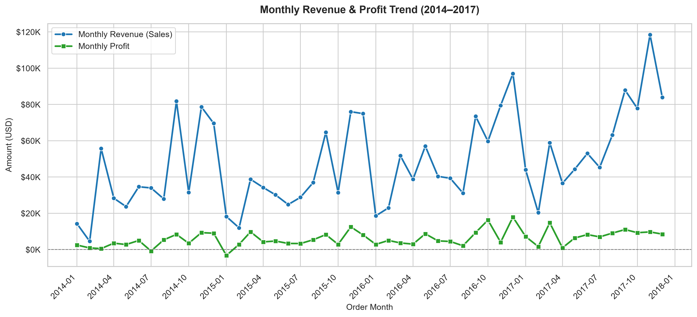
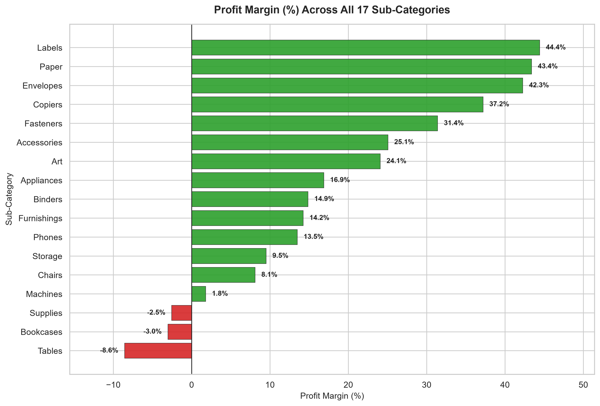

# US Superstore Sales Analytics & Business Intelligence Platform

An end-to-end retail data engineering, warehousing, exploratory analytics, and executive reporting solution built with **Python**, **MySQL 8.0**, **OpenPyXL**, **Jupyter**, **Pytest**, and **Power BI**.

This platform transforms raw transactional retail data (`9,994` line items across `2014–2017`) into a reconciled Star Schema data warehouse, an interactive EDA notebook, publication-ready charts, a conditionally formatted 5-sheet Executive Excel workbook, and a 3-page Power BI dashboard specification.

---

## 1. Executive Summary & Quantified Business Findings

| Metric | Verified Value |
|---|---|
| **Total Revenue (2014–2017)** | **$2,297,200.86** (~$2.30M) |
| **Total Net Profit** | **$286,397.02** (~$286.40K) |
| **Overall Operating Margin** | **12.47%** |
| **Order & Unit Volume** | **5,009** Orders \| **37,873** Units \| **9,994** Line Items |
| **Average Order Value (AOV)** | **$458.61** |
| **Customer & SKU Footprint** | **793** Customers \| **1,862** Unique Product IDs |

### Key Analytical Insights
1. **Hard Profitability Cliff Above 20% Discount:**
   - Line items at `0%` discount achieve a **29.51% weighted margin** (`0.00%` loss rate), and `11%–20%` discounts remain profitable (**11.58% weighted margin**, **$91,756.30** net profit).
   - Exceeding **20% discount** collapses unit economics: `21%–40%` discounts yield **-15.30% weighted margin** (**90.22%** loss rate), while `>40%` clearance plunges to **-77.40% weighted margin** (**100.00%** loss rate), generating **-$135,376.06** in cumulative losses across `discount > 20%` transactions.
2. **Localized Sub-Category Margin Leakage:**
   - Only **3 of 17** sub-categories are net loss-makers: **Tables (`-$17,725.48`, `-8.56%` margin)**, **Bookcases (`-$3,472.56`, `-3.02%` margin)**, and **Supplies (`-$1,189.10`, `-2.55%` margin)**.
   - High-margin consumables and office technology (**Labels `+44.4%`**, **Paper `+43.4%`**, **Envelopes `+42.3%`**, **Copiers `+37.2%`**) subsidize heavy furniture discounting.
3. **Regional Margin Gap (`West` vs. `Central`):**
   - **West** leads with **$725,457.82** in sales and **$108,418.45** in profit (**14.94% margin**, **10.93%** average discount).
   - **Central** generates **$501,239.89** in sales (28% more than **South**'s `$391,721.91`) yet delivers less profit (**$39,706.36**, **7.92% margin**) because its **24.04% average discount rate** is more than double West's.
4. **Macro Growth & Q4 Seasonality:**
   - Annual profit grew every consecutive year from **$49,543.97 (2014)** to **$93,439.27 (2017)**, with revenue surges concentrated in **September–December** (peak month: November at **$352,461.07**).

---

## 2. Visual Previews

### Monthly Revenue & Profit Trend (2014–2017)


### Sub-Category Profit Margin (%) Breakdown


---

## 3. End-to-End Architecture & Folder Structure

```text
data/raw/Sample - Superstore.csv
        │
        ▼
[ src/main.py ] ──▶ Clean CSV + Parquet (data/processed/) + Data Quality Report
        │
        ├──▶ [ src/load_to_mysql.py ]       ──▶ MySQL 8.0 Star Schema & 6 Views (sales_analytics_db)
        ├──▶ [ src/generate_charts.py ]     ──▶ 300 DPI Charts (reports/figures/)
        ├──▶ [ src/generate_excel_report.py ] ▶ 5-Sheet Styled Workbook (reports/Executive_Sales_Report.xlsx)
        ├──▶ [ src/export_powerbi_views.py ]  ▶ 11 Power BI CSV Extracts (powerbi/data_extracts/)
        └──▶ [ notebooks/01_exploratory_data_analysis.ipynb ] ▶ Headlessly Executed EDA
```

```text
Sales-Analytics-Project/
├── data/
│   ├── raw/                             # Immutable raw source dataset
│   └── processed/                       # Cleaned & enriched CSV + Parquet datasets
├── docs/
│   └── phase4_database_documentation.md # Relational modeling & schema notes
├── notebooks/
│   └── 01_exploratory_data_analysis.ipynb # Executed 7-section EDA notebook
├── powerbi/
│   ├── POWERBI_DASHBOARD_GUIDE.md       # MySQL setup, DAX library, 3-page wireframe
│   └── data_extracts/                   # 11 reconciled Star Schema & view CSV extracts
├── reports/
│   ├── Executive_Sales_Report.xlsx      # 5-sheet formatted executive Excel workbook
│   ├── data_quality_report.md           # Automated ETL audit report
│   ├── phase4_validation_report.md      # Database reconciliation documentation
│   └── figures/                         # 300 DPI PNG analytical charts
├── sql/
│   ├── 01_create_database_and_tables.sql # Star Schema DDL (dimensions, fact, FKs, indexes)
│   ├── 02_data_ingestion.sql            # SQL ingestion reference
│   ├── 03_analytical_queries.sql        # 20 BI queries (CTEs, window functions, RFM)
│   └── 04_views_for_powerbi.sql         # 6 pre-aggregated Power BI views
├── src/
│   ├── data_loader.py                   # Raw CSV ingestion & schema checks
│   ├── cleaner.py                       # Standardization, duplicate audit & feature engineering
│   ├── main.py                          # Phase 3 ETL entrypoint
│   ├── load_to_mysql.py                 # MySQL Star Schema loader & reconciliation suite
│   ├── verify_phase5.py                 # Analytical SQL query runner
│   ├── generate_charts.py               # 300 DPI Matplotlib/Seaborn figure generator
│   ├── generate_excel_report.py         # OpenPyXL executive workbook generator
│   ├── export_powerbi_views.py          # Star Schema & view CSV exporter
│   └── run_pipeline.py                  # End-to-end pipeline orchestrator
├── tests/
│   ├── test_cleaning.py                 # Unit tests for ETL, duplicates, and edge cases
│   └── test_reporting_and_exports.py    # Integration tests for charts, Excel, and Power BI CSVs
├── requirements.txt                     # Pinned Python dependencies
├── .gitignore
└── README.md
```

---

## 4. Star Schema Data Warehouse Design

Designed in [`sql/01_create_database_and_tables.sql`](sql/01_create_database_and_tables.sql) and [`sql/04_views_for_powerbi.sql`](sql/04_views_for_powerbi.sql):

- **Dimension Tables (`1:*` relationships to `fact_sales`):**
  - `dim_date` (`date_key` PK, `full_date`, `year`, `month`, `month_name`, `quarter`, `day_name`) — supports role-playing relationships on `order_date_key` and `ship_date_key`.
  - `dim_customer` (`customer_key` PK, `customer_id`, `customer_name`, `segment`).
  - `dim_product` (`product_key` PK, `product_id`, `product_name`, `category`, `sub_category`).
  - `dim_location` (`location_key` PK, `country`, `city`, `state`, `postal_code`, `region`).
- **Fact Table:**
  - `fact_sales` (`row_id` PK preserving all `9,994` records including audited Row IDs `3406` & `3407`, `order_id`, FKs to all dimensions, `ship_mode`, `sales`, `quantity`, `discount`, `profit`, `total_cost`, `unit_selling_price`, `unit_cost`, `profit_margin_pct`, `shipping_duration_days`).
- **Analytical Views (`vw_*`):**
  - `vw_sales_summary`, `vw_monthly_sales`, `vw_category_performance`, `vw_region_performance`, `vw_product_performance`, `vw_customer_performance`.

---

## 5. Tech Stack

- **Language & Environment:** Python 3.14, `venv`
- **Data Engineering:** `pandas`, `numpy`, `pyarrow`
- **Database & SQL:** MySQL 8.0+, `PyMySQL`, `mysql-connector-python`, `SQLAlchemy`
- **Visualization & Notebooks:** `matplotlib`, `seaborn`, `ipykernel`, `jupyter_client`
- **Reporting & BI:** `openpyxl`, Microsoft Power BI Desktop (DAX & Star Schema model)
- **Testing & Quality:** `pytest`

---

## 6. Quickstart Setup & Execution (Windows PowerShell)

### 1. Create & Activate Virtual Environment
```powershell
python -m venv venv
.\venv\Scripts\Activate.ps1
pip install -r requirements.txt
```

### 2. Run the Full End-to-End Local Pipeline
Runs ETL cleaning, chart generation, Executive Excel report generation, and Power BI CSV extraction (`--skip-mysql` is enabled by default):
```powershell
.\venv\Scripts\python.exe src/run_pipeline.py
```

### 3. Optional: Load & Verify MySQL Star Schema (`sales_analytics_db`)
Ensure MySQL is running on `localhost:3306`, then either pass `--no-skip-mysql` to the orchestrator or run the MySQL utilities directly:
```powershell
.\venv\Scripts\python.exe src/run_pipeline.py --no-skip-mysql --mysql-user root
# Or standalone ingestion & Phase 5 query verification:
.\venv\Scripts\python.exe src/load_to_mysql.py --user root
.\venv\Scripts\python.exe src/verify_phase5.py --user root
```

### 4. Run Automated Test Suite
```powershell
.\venv\Scripts\python.exe -m pytest -v
```
