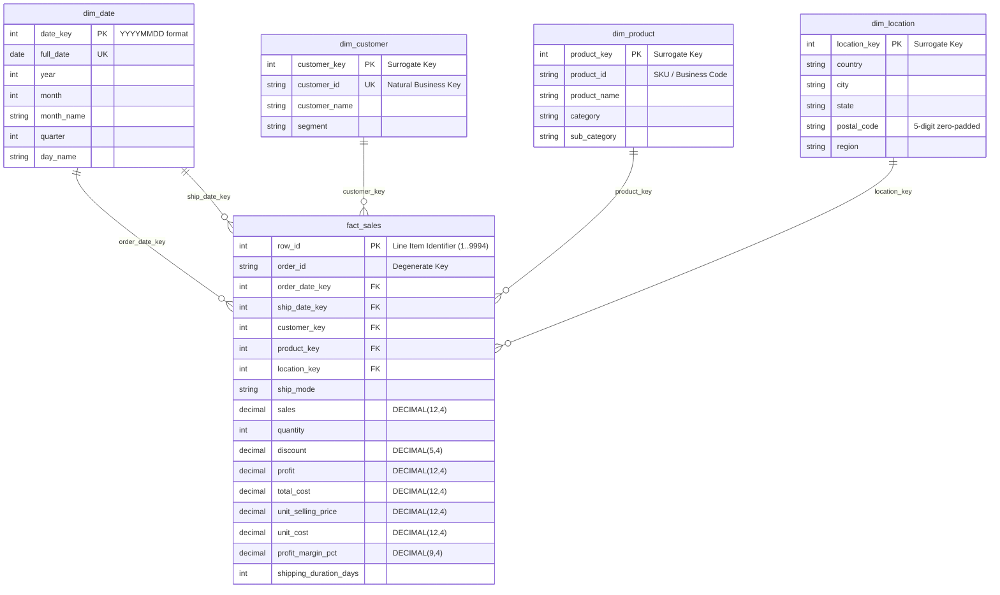

# Phase 4 Database Modeling & Star Schema Technical Documentation

**Project:** Sales Data Analysis & Business Intelligence Dashboard  
**Database Name:** `sales_analytics_db`  
**RDBMS Target:** MySQL 8.0+  
**Architecture:** Dimensional Modeling (Kimball Star Schema)  
**Author:** Senior Data Engineer & Database Architect  

---

## 1. Fundamentals of Relational Databases & Dimensional Modeling

### What is a Relational Database?
A relational database is an organized collection of structured data formatted into tables consisting of rows and columns. It enforces mathematical integrity rules (entity integrity, referential integrity, and domain constraints) using Structured Query Language (SQL) and ensures ACID transactions (Atomicity, Consistency, Isolation, Durability).

### What is a Star Schema?
A **Star Schema** is the industry-standard dimensional modeling architecture optimized for decision-support queries, online analytical processing (OLAP), data warehousing, and business intelligence reporting. 

The design consists of:
- A single **central Fact Table** containing measurable numerical metrics and transactions.
- Surrounding **Dimension Tables** containing descriptive business attributes (who, what, where, when).
- The visual layout resembles a star radiating outward from the central fact table to its dimensional points.

### Fact Tables vs. Dimension Tables

| Characteristic | Fact Table (`fact_sales`) | Dimension Tables (`dim_customer`, `dim_product`, etc.) |
| :--- | :--- | :--- |
| **Business Role** | Records observed business events and transactions | Provides contextual filters, hierarchies, and groupings |
| **Typical Contents** | Quantitative measures (Sales, Profit, Quantity, Cost) | Descriptive text attributes (Names, Categories, Regions) |
| **Grain** | One row per sales transaction line item (atomic level) | One row per unique entity instance |
| **Key Types** | Surrogate Primary Key + Multiple Foreign Keys | Surrogate Primary Key + Natural Business Key |
| **Growth Pattern** | Rapidly grows as new transactions occur | Slow-growing or static reference data |

### Primary Keys vs. Foreign Keys
- **Primary Key (PK):** A column or set of columns that uniquely identifies every record in a table. In our architecture, surrogate keys (auto-incrementing integers) provide optimal storage, indexing performance, and isolation from changing source business identifiers.
- **Foreign Key (FK):** A column in the fact table that references the primary key of a dimension table, establishing referential integrity and guaranteeing that no orphan transactions can exist.

### Why `row_id` is the Primary Key of `fact_sales`
- In the retail sales dataset, `order_id` cannot serve as the primary key because an order frequently contains multiple product lines.
- A composite key of `(order_id, product_id)` is also disqualified because a single order may contain multiple distinct line items of the same product (as demonstrated by our verified business duplicate pair `Row ID 3406` and `Row ID 3407`).
- Therefore, the immutable sequential integer **`row_id`** (1 to 9,994) serves as the true atomic surrogate primary key, guaranteeing 100% uniqueness without data loss.

---

## 2. Star Schema Architecture Diagram



---

## 3. Detailed Table Specifications & Data Dictionaries

### 1. `dim_date` (Calendar Dimension)
- **Role:** Conformed date dimension serving two **role-playing relationships**:
  1. `order_date_key` $\rightarrow$ `dim_date.date_key` (When the purchase was made)
  2. `ship_date_key` $\rightarrow$ `dim_date.date_key` (When the shipment was fulfilled)
- **Primary Key:** `date_key` (`INT` in `YYYYMMDD` format, e.g., `20140423`).
- **Total Records:** 1,434 unique calendar days covering 2014 through early 2018.

### 2. `dim_customer` (Customer Dimension)
- **Primary Key:** `customer_key` (`INT AUTO_INCREMENT`).
- **Natural Key:** `customer_id` (`VARCHAR(20) UNIQUE`).
- **Total Records:** 793 unique customers.

### 3. `dim_product` (Product Catalog Dimension)
- **Primary Key:** `product_key` (`INT AUTO_INCREMENT`).
- **Attributes:** `product_id`, `product_name`, `category`, `sub_category`.
- **Total Records:** 1,894 distinct product configurations.

### 4. `dim_location` (Geographic Destination Dimension)
- **Primary Key:** `location_key` (`INT AUTO_INCREMENT`).
- **Attributes:** `country`, `city`, `state`, `postal_code` (standardized 5-digit padded string), `region`.
- **Total Records:** 632 unique geographic points.

### 5. `fact_sales` (Central Transaction Fact Table)
- **Grain:** One row per individual sales transaction line item.
- **Total Rows:** Exactly **9,994 records** (reconciled 100% with raw and processed datasets).
- **Measures:** All financial metrics utilize `DECIMAL(12, 4)` to eliminate floating-point approximation errors inherent in `FLOAT` / `DOUBLE`.

---

## 4. Execution Guide: Step-by-Step SQL Ingestion

### Option A: Direct MySQL Ingestion (via MySQL Workbench or CLI)

1. **Step 1 — Create Database and Tables:**
   Open and execute:
   [`sql/01_create_database_and_tables.sql`](file:///d:/one%20drive/OneDrive/Desktop/Sales-Analytics-Project/sql/01_create_database_and_tables.sql)

2. **Step 2 — Load Data & Populate Dimensions:**
   Open and execute:
   [`sql/02_data_ingestion.sql`](file:///d:/one%20drive/OneDrive/Desktop/Sales-Analytics-Project/sql/02_data_ingestion.sql)
   - Ensure `local_infile = 1` is enabled in MySQL Server.
   - If loading from Windows, ensure file path backslashes are escaped or written with forward slashes (`/`).

3. **Step 3 — Deploy Power BI Analytical Views:**
   Open and execute:
   [`sql/04_views_for_powerbi.sql`](file:///d:/one%20drive/OneDrive/Desktop/Sales-Analytics-Project/sql/04_views_for_powerbi.sql)

4. **Step 4 — Execute Analytical Intelligence Queries:**
   Open and run queries from:
   [`sql/03_analytical_queries.sql`](file:///d:/one%20drive/OneDrive/Desktop/Sales-Analytics-Project/sql/03_analytical_queries.sql)

---

### Option B: Python-Based Automated Database Loader

If direct `LOAD DATA LOCAL INFILE` permissions are restricted in your MySQL configuration, run our standalone Python ingestion utility:

```bash
# 1. Install MySQL driver dependencies
pip install pymysql mysql-connector-python

# 2. Run the loader script
python src/load_to_mysql.py --host localhost --port 3306 --user root
```
*(You will be prompted securely for your MySQL password without echoing to the screen).*

The loader script will automatically:
1. Connect to MySQL.
2. Execute `01_create_database_and_tables.sql`.
3. Read `data/processed/clean_superstore.csv`.
4. Populate all four dimensions and resolve surrogate foreign keys into `fact_sales`.
5. Deploy all six analytical views from `04_views_for_powerbi.sql`.
6. Run the reconciliation assertions and print the pass/fail scorecard.

---

## 5. Connecting Microsoft Power BI to the MySQL Database (Phase 5 Preview)

When proceeding to Phase 5, connecting Power BI to the modeled database follows these steps:

1. **Launch Microsoft Power BI Desktop.**
2. Select **Get Data** $\rightarrow$ **Database** $\rightarrow$ **MySQL database**.
3. In the Connection dialog:
   - **Server:** `localhost:3306` (or `127.0.0.1:3306`)
   - **Database:** `sales_analytics_db`
   - **Data Connectivity mode:** Select **Import** (recommended for sub-100k rows) or **DirectQuery**.
4. Enter MySQL credentials when prompted (**Database** authentication method $\rightarrow$ Username: `root`, Password: `<your_password>`).
5. In the Navigator window, select the Star Schema tables:
   - `fact_sales`
   - `dim_date`
   - `dim_customer`
   - `dim_product`
   - `dim_location`
   *(Or connect directly to pre-aggregated views: `vw_sales_summary`, `vw_monthly_sales`, etc.)*
6. In Power BI **Model View**, verify the active 1-to-many (`1:*`) relationships:
   - `dim_date[date_key]` $\rightarrow$ `fact_sales[order_date_key]` (Active)
   - `dim_date[date_key]` $\rightarrow$ `fact_sales[ship_date_key]` (Inactive, activated in DAX using `USERELATIONSHIP`)
   - `dim_customer[customer_key]` $\rightarrow$ `fact_sales[customer_key]`
   - `dim_product[product_key]` $\rightarrow$ `fact_sales[product_key]`
   - `dim_location[location_key]` $\rightarrow$ `fact_sales[location_key]`
